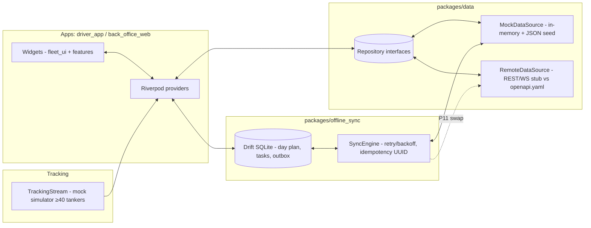

# 02 — Frontend Architecture (Flutter, UI-first)

> Melos monorepo. Clean Architecture + feature-first apps. UI-first runs on **mock data through the production repository interfaces**, so swapping `MockDataSource` → `RemoteDataSource` later is a one-flag change with zero widget rewrites.
> UI centralization (screens carry zero styling; everything through `Theme.of(context)` + TT* components): normative spec is `08-ui-centralization.md`; token values are in `04-design-system.md`.

## 1. Repo layout

```
tankertrack/
  melos.yaml                    # workspace + scripts (analyze, test, gen-l10n, goldens)
  pubspec.yaml (root, workspace)
  apps/
    driver_app/                 # mobile (Android/iOS): DR-01..18
      lib/main.dart, app.dart, router.dart, features/<day|task|loading|pod|…>/
    back_office_web/            # web (all BO-* + /control-room CR)
      lib/main.dart, app.dart, router.dart, features/<orders|dispatch|map|…>/
      web/manifest, icons
  packages/
    design_system/              # tokens, theme, components (04-design-system.md)
    core/                       # Result<T>, AppError, config/env, feature flags, logging, RBAC helpers
    l10n/                       # app_en.arb, app_ar.arb, gen-l10n, formatters (IG/L, dates, numerals), RTL helpers
    domain/                     # entities, Quantity(IG), enums, 5 state machines, validators, ledger rules
    data/                       # repositories + DTOs + mappers; MockDataSource + RemoteDataSource (REST+WS stub)
    offline_sync/               # Drift/SQLite local DB, outbox, sync engine, connectivity, GPS buffer, conflict model
    fleet_ui/                   # status chips, order/trip cards, map widgets, qty widgets, timeline, signature pad
  docs/plan/ (this folder)
  openapi.yaml (P10 contract; data package coded against it from P0)
```

**Dependency rule (strict, enforced by import lint):** `apps → fleet_ui → data → domain`; `apps → offline_sync → data`; `design_system`, `core`, `l10n` are leaf deps (depend on nothing internal); `domain` depends only on `core`. Widgets never import `data` data-sources directly — only repository interfaces. No business logic in widgets (enforced in review checklist).

## 2. State, routing, roles

- **State:** Riverpod (`flutter_riverpod`). One `ProviderContainer` per app. Async state as `AsyncValue<Result<T>>`. Feature-scoped providers (`todayPlanProvider`, `tripDetailProvider`, `fleetPositionsProvider`, `outboxProvider`); global: `authProvider`, `localeProvider`, `connectivityProvider`, `configProvider`, `roleProvider` (demo switcher).
- **Routing:** `go_router` with typed routes + `redirect` role guards. Roles enum mirrors FRS §4 (admin, sales, dispatcher, fleetController, driver, supervisor, finance, customerStub). Every route declares `allowedRoles`; guard redirects to `/login` or `/403` (finished empty-state, not TODO). Deep links: `/orders/:id`, `/trips/:id`, `/control-room` (no auth in kiosk demo mode behind flag, else supervisor+).
- **RBAC widgets:** `RoleGate(roles:…, child:…)` + `PermissionButton` (hides/disables + tooltip reason). Permissions matrix in `core/rbac.dart`, unit-tested.

## 3. Data flow (mock ↔ remote seam)



- **One-flag switch:** `DataConfig.source = mock | remote` (env + demo panel). UI code identical either way.
- **DTO discipline:** JSON keys mirror `openapi.yaml` from P0 (drafted in P10 but field names frozen here: snake_case, `qty_ig`, `name_en/name_ar`, `captured_at/device`, `client_uuid`).
- **Errors:** `Result<T>` (ok/err) + `AppError` (network, offline-queued, conflict, validation, forbidden). Global error boundary per app + per-feature error states (never red-screen in demo).

## 4. Domain core (P0, unit-tested, no Flutter imports)

- `QuantityIG`: the domain stores Imperial Gallons as an **integer count of tenths of a gallon** (`int tenthGallons`; 1 IG = 10 units), so all ledger arithmetic is exact integer math with zero floating-point drift. Display formatting rounds to 1 decimal IG; litre conversion (`tenthGallons × 0.454609`, rate from config default 4.54609 L/IG) is display-only and never stored. `QuantityIG` is a value object with `+`, `-`, `compareTo`, `isZero`, `toLitres()`. Ledger tests assert exact integer reconciliation (e.g. 40000 − 15000 = 25000 tenths = 2500.0 IG).
- **State machines:** generic `StateMachine<S,E>` + five instances (Order 10, Trip 11, Task 9, Vehicle 9, Driver 9) with `allowedTransitions` maps + `canTransition` + transition tests for every edge. Derived display states (§6 transit phases, Scheduled/Delivered aliases) are pure functions, not states.
- **Validators/rules:** `OrderValidator` (mandatory coords/product/qty/date), `DispatchRules` (capacity, overlap, maintenance/critical-defect block, credential block), `LedgerRule` (Opening+Loaded−Delivered−Returned±Adj=Closing; delivery ≤ on-board w/o override; tolerance check), `PodPolicy` (name + sig/photo gate).
- **Reason codes:** bilingual `ReasonCode(code, name_en, name_ar, appliesTo)`; every override/reassign/adjust needs one (audit).

## 5. Offline-sync design (built P0-foundations, completed P5, used P3/P4)

- **Local DB (Drift/SQLite, encrypted at rest via `sqlcipher_flutter_libs`):** tables `day_plan, tasks, customers, sites, checklist_tpl, events_outbox, gps_buffer, attachments`. Day plan + masters pre-seeded at login (synced snapshot readable offline).
- **Outbox:** every mutating driver action (arrive, load, unload, POD, break, inspection, incident, start/end day) → row with `client_uuid (PK)`, `type`, `payload_json`, `captured_at`, `retry_count`, `state (pending/sending/failed/conflicted)`. SyncEngine: FIFO + exponential backoff (1s,5s,30s,2m,10m), batch upload, idempotent against mock remote (dedupe by `client_uuid`).
- **Photos/signatures:** saved locally immediately; `attachments` rows upload AFTER parent transaction ACKs (background isolate, progress badges).
- **GPS buffer:** ring buffer (10k points), flush on reconnect, gap flags (`gap=true` segments rendered dashed on replay).
- **Conflict model:** server reject (e.g. task reassigned while offline) → `conflicted` state + Conflict Sheet UI (theirs/yours/merge-take-server + reason + audit). Never silent overwrite.
- **UI states:** connectivity banner (Online/Offline/Flaky), GPS dot, last-sync "2 min ago" (localized), per-item badges Pending/Synced/Failed, manual Sync-now button.
- **Mock remote toggle:** hidden demo panel (7-tap version or `?demo` query): Online / Offline / Flaky (30% drop + 3 s latency) / Stale-GPS. Works on web too (back-office degraded banner + stale timestamps; CR marks stale vehicles).

## 6. Tracking & maps abstraction

- `TrackingStream` interface: `Stream<List<VehiclePosition>> positions({required List<String> vehicleIds})`, `Stream<FleetEvent> events()`. P0–P7: `MockTrackingSimulator` (≥40 tankers on polyline routes, speed/heading/trail, scripted delay/breakdown/loading events + noise). P11: `WsTrackingStream` (STOMP) — same interface.
- `MapAdapter` interface (`flutter_map`/OSM tile impl now; Google Maps impl later): `showMarkers`, `trail`, `cluster`, `focusOn`, `rtlAwareControls`. Nav hand-off: `launchExternalMaps(lat,lng)` (geo:/universal link) — abstracted for test.
- Performance: marker diff (not rebuild), clustering >25 markers, trail capped 200 pts/vehicle, 60 fps budget on control-room (profiled in P9).

## 7. RTL / l10n strategy (first-class, day one)

- `gen-l10n` ARBs (`app_en.arb` 1:1 key parity with `app_ar.arb`; CI fails on missing key). **Zero hard-coded strings** (lint: `no_raw_text` custom rule on widgets).
- Directionality-only widgets: `EdgeInsetsDirectional`, `AlignmentDirectional`, `start/end`, `ListView` default (auto-mirrors), mirrored direction icons (`Icons.arrow_forward` auto-mirrors via `Directionality`; custom SVGs paired `*_rtl`).
- Font: **IBM Plex Sans Arabic** (UI) + **Noto Sans Arabic** fallback; line-height 1.6 for Arabic (vs 1.45 Latin) via locale-aware `TextTheme` extension. Verified weights 400/500/700 render Arabic without clipping.
- Numbers/dates: `NumberFmt` (Western vs Arabic-Indic numerals toggle), `DateFmt` (Gregorian + optional Hijri via `hijri` pkg display-only), timezone-aware: UTC stored; display in the configured tz (configurable in Configuration screen, default `Asia/Riyadh` until the client confirms).
- Units localized: "IG" → "غالون إمبراطوري" short "غ.إ" with IG numerals; litre toggle converts display only.
- Goldens: every key screen rendered en-LTR + ar-RTL (P0 harness, P9 full pass). Maps/charts/tables/signature/PDF-preview/notifications all in golden set.

## 8. Config & environments

- `AppConfig` (per env dev/demo/prod json): apiBase, wsBase, tileUrl, gps intervals, tolerances, geofence radii, POD policy, flags (compartments, OTP, accept-required, inspection-before-start). Remote-config endpoint designed (static in UI-first). Demo role switcher + Online/Offline/Flaky panel only in dev/demo builds (compile-guard).
- Logging: `AppLog` (debug/info/warn/error + breadcrumb ring); crash-safe startup (runZonedGuarded + error screen with report ID, never blank).

## 9. Testing strategy (frontend)

| Level | Scope | Gate |
|-------|-------|------|
| Unit | 5 state machines, ledger math, validators, mappers, formatters | `flutter test`, 100% domain |
| Widget | forms (loading/unloading/POD), guards, outbox badges, RTL smoke | per-phase |
| Golden | key screens × (light/dark) × (en-LTR/ar-RTL) | threshold 0.5%, reviewed diffs |
| Integration | driver day flow; offline→online sync (flaky mock) | P5+ |
| Perf | 100-order lists, 100-marker map, CR 4K | P9 budgets |

Melos scripts: `melos analyze`, `melos test`, `melos goldens`, `melos gen`.
