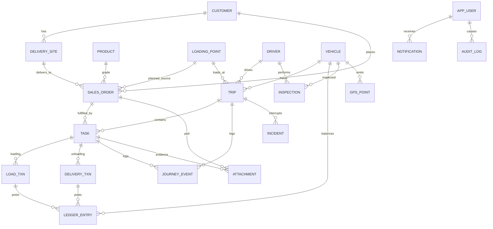

# 03 — Backend Architecture (Java 21 + Spring Boot 3, skeleton in UI-first)

> UI-first delivers: this doc + ER diagram + API list + OpenAPI contract + compilable module skeleton + Flyway baseline + docker-compose. **No business logic yet.** Everything below is the build-to target so the Flutter `RemoteDataSource` plugs in without UI rewrites (P11).

## 1. Style: modular monolith, strict boundaries

- Single deployable, **12 modules** (Gradle multi-module or Maven modules — decide P10; recommend Gradle Kotlin DSL). Each module: own package root `com.tankertrack.<module>`, own Flyway history, own REST controllers; cross-module calls ONLY via public `api` sub-package (ArchUnit test fails on illegal imports).
- Modules: `iam`, `masterdata`, `orders`, `dispatch`, `driverops`, `ledger`, `tracking`, `alerts`, `incidents`, `reporting`, `audit`, `config`. Phase-2 placeholders: `erp` (stub), `telematics` (stub), `maintenance` (stub) — packages exist, controllers return 501 with reason.
- Async internals: domain events via Spring Modulith events (in-JVM now, RabbitMQ/Kafka swap later). **GPS ingest path never blocks order path** (separate thread pool + backpressure, FRS §33).

## 2. Stack

| Concern | Choice |
|---------|--------|
| Runtime | Java 21, Spring Boot 3.3, virtual threads (`spring.threads.virtual.enabled=true`) |
| DB | PostgreSQL 16 + PostGIS (geo), Flyway baseline `V1__init.sql` in UI-first |
| Hot state | Redis 7 (live positions `veh:{id}`, pub/sub `fleet.*`, idempotency keys `idem:{uuid}` TTL 7 d) |
| Files | S3-compatible (MinIO in compose) for POD/photos/tickets; metadata in PG, bytes in S3 |
| Live push | WebSocket STOMP `/ws/fleet` (topics `/topic/positions`, `/topic/alerts`, `/topic/orders`) |
| Auth | OAuth2-resource-server JWT (15 min) + rotating refresh (driver 12 h / office 8 h); TOTP MFA for admin/supervisor; device binding for drivers + remote disable |
| i18n | `name_en/name_ar` columns on reason codes, statuses, checklist items, notification templates; `Accept-Language` + per-user locale |
| Time/money | timestamptz (UTC) everywhere; device `captured_at` stored separately; qty `numeric(12,1)` IG; configurable litre rate |
| API style | OpenAPI-first (`openapi.yaml` is the contract; server stubs generated; Flutter DTOs hand-aligned) |
| Observability | Actuator + OpenTelemetry traces; audit table append-only (no UPDATE/DELETE grants) |

docker-compose (UI-first): `postgres:16-postgis`, `redis:7`, `minio`, `app` (skeleton, health endpoint only).

## 3. ER diagram (covers FRS §21, 18 entities)

Key tables (V1 baseline): `customer, delivery_site, product, loading_point, driver, vehicle (+compartments[] JSONB, disabled), sales_order, trip, task, load_txn, delivery_txn, ledger_entry (running balance), gps_point (PostGIS geography, partitioned by month), journey_event, inspection (+items JSONB), incident, attachment (s3_key), notification, audit_log (append-only), reason_code (en/ar), app_user/role/device, app_config`. All user-facing code tables carry `name_en, name_ar`.

## 4. API list (v1, OpenAPI; skeleton returns 501/empty page in UI-first except /health)

- `iam`: `POST /auth/login|refresh|mfa/verify`, `POST /drivers/{id}/devices/disable`, CRUD `/users /roles`
- `masterdata`: CRUD `/customers /sites /products /loading-points /drivers /vehicles` (+ `/vehicles/{id}/calendar`, `/drivers/{id}/calendar`, doc-expiry queries)
- `orders`: CRUD `/orders` (+ bulk `POST /orders:bulk`, `POST /orders/{id}/cancel|hold|release` with reason)
- `dispatch`: `POST /trips` (create run + sequence), `PATCH /trips/{id}/sequence`, `POST /trips/{id}/dispatch|assign|reassign|close|amend-request`, `GET /dispatch/board?date=`, `POST /dispatch/suggest-sequence`
- `driverops`: `POST /shifts/start|end`, `POST /inspections`, `POST /tasks/{id}/arrive|start|complete|fail|skip`, `POST /loads`, `POST /deliveries`, `POST /pod`, `POST /breaks`, `POST /sync:upload (batch)`, `GET /sync:plan?driver=&date=` (delta pull)
- `ledger`: `GET /vehicles/{id}/ledger`, `GET /reconciliation?date=&vehicle=`, `POST /adjustments` (supervisor, reason)
- `tracking`: `POST /positions:batch` (telematics/driver), `GET /vehicles/live`, `GET /trips/{id}/replay`, WebSocket `/ws/fleet`
- `alerts`: `GET /alerts`, `PATCH /alerts/{id}/ack`, `GET /notifications`, push registration
- `incidents`: CRUD `/incidents` (+ resolve/close with auth user)
- `reporting`: `GET /reports/{daily-ops|driver-activity|…}` + `?format=json|xlsx|pdf|csv`
- `audit`: `GET /audit?entity=&id=` (read-only)
- `config`: `GET/PATCH /config` (tolerances, GPS, geofence, POD policy, flags) — admin only

## 5. Sync protocol for offline clients (FRS §23/§24)

1. **Pull:** `GET /sync:plan` returns day snapshot `{server_time, plan_version, tasks[], masters_hash}` — cached in Drift; `If-None-Match: plan_version` → 304.
2. **Push:** `POST /sync:upload {events:[{client_uuid, type, captured_at, payload}]}` → per-event results `{client_uuid: ok|duplicate|conflict(reason)}`. Idempotent: `client_uuid` UNIQUE; retries return `duplicate:ok` without double-posting.
3. **Ordering:** server applies in `captured_at` order per device; ledger posts are serialised per vehicle (row lock) to keep balance exact.
4. **Conflicts:** task reassigned/voided while offline, stale plan_version, over-balance without override → `conflict` with `server_state` payload; client shows Conflict Sheet (theirs/yours), resolution re-uploads with `supersedes` + reason + audit.
5. **Media:** transactions first, attachments second (`POST /attachments` multipart with `client_uuid` + parent ref; resumable).
6. **Time:** server stamps `received_at/server_at`; original `captured_at` immutable (both shown in UI).

## 6. Security & governance (maps FRS §26)

JWT short-lived + refresh rotation + device binding (driver `device_id`, max 2, admin remote-disable → 401 + wipe signal); MFA TOTP for admin/supervisor/finance; RBAC least-privilege (permission matrix mirrored from Flutter `core/rbac.dart`); TLS everywhere, AES-256 at rest (PG TDE/volume encryption + S3 SSE), secrets in vault (compose uses placeholder); audit append-only (DB REVOKE UPDATE/DELETE for app role); retention jobs per `retention.*` config; duty-only location policy text served from `/config/privacy` (shown in driver app banner).

## 7. Events (internal, Modulith)

`OrderCreated/Assigned/Reassigned/Cancelled`, `TripDispatched/Closed/AmendRequested`, `LoadRecorded`, `DeliveryCompleted/VarianceFlagged`, `PodCaptured`, `GpsStale/Deviation/ProlongedStop`, `BreakdownReported/Resolved`, `InspectionFailed/CriticalDefect`, `SyncConflict`. `tracking` and `alerts` subscribe without slowing `orders/dispatch` (separate executors; load-shedding on GPS topic).

## 8. UI-first skeleton acceptance (P10)

`./gradlew bootRun` compiles + `/health` 200 via compose; Flyway V1 applies clean; OpenAPI validates (spectral, no breaking drift vs Flutter DTOs); ArchUnit boundary test green; `openapi.yaml` field names == Flutter `data` DTO keys (CI diff check).
